# ND Long Exposure Timer

A small box on your camera's hot shoe for long exposures with ND filters. You pick the
exposure time you want; it tells you which filters to put on and the ISO and aperture
to match. No maths, no guessing. At night it is a plain long-exposure timer too. (Select mode: "no filters")

**Try it in your browser:** https://antondegroot.github.io/ND-Long-Exposure-Timer/

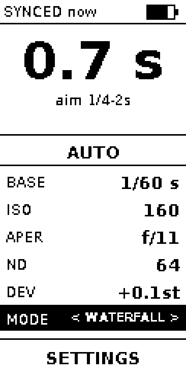

How it works:
1. Meter the scene on your camera as usual and press **SYNC**.
2. Pick the total exposure time.
3. Screw on the filters it lists and press **SHOOT**.

At night, scroll the scenario to **NO FILTERS**: no SYNC needed. Set the time, ISO and
aperture, and SHOOT puts them on the camera and runs the exposure.

## Controls

| Control | Does |
|---------|------|
| Five-way ↔↕ | navigate |
| Five-way centre | select |
| SYNC | read the current exposure settings from the camera |
| SHOOT | start the shot; hold to cancel |

What every screen means: [docs/screens.md](docs/screens.md).

## 1. Buy

**Cost:** about €130 for a first build, bought in the Netherlands (prices of October 2026,
with VAT, without shipping). €64 of that is the Pi, the UPS HAT, the display and the
breakout board; the rest is small parts, which mostly come in packs. If you already have
those, it comes down to about €64.

<details>
<summary>Show the parts list</summary>

| Part | Qty |
|------|-----|
| Raspberry Pi Zero 2 W (a plain Zero works, but boots in ~25s instead of ~11s) | 1 |
| 2.13" e-paper display HAT | 1 |
| UPS HAT for Pi Zero, with 1000mAh cell | 1 |
| Breakout Pi Zero (AB Electronics) | 1 |
| Five-way navigation button | 1 |
| 16mm momentary power button with LED ring (1NO1NC, 3-6V ring) | 1 |
| 12x12mm momentary tactile button (TLYCRQJXF), for SYNC and SHOOT | 2 |
| BC337 NPN transistor (TO-92) | 2 |
| AO3401 P-channel MOSFET (SOT-23) + SOT-23 to SIP3 adapter | 1 |
| Pin header, 1x3, straight, 2.54mm (to stand the adapter on) | 1 |
| BAT85 Schottky diode | 2 |
| Resistors, 1/8W (3.5x1.8mm; the 1W ones are too big to fit it on the board): 1kΩ, 10kΩ, 10kΩ, 10kΩ, 10kΩ, 22kΩ | 6 |
| Ceramic capacitors, through-hole: 100nF, and 10µF X5R/X7R 6.3V or more (a 10µF electrolytic also works) | 2 |
| USB-C power-only socket | 1 |
| Micro-USB solder plug, 5 pin (one for power, one for the camera) | 2 |
| USB-A socket, 4 pin | 1 |
| USB-A to camera cable (UC-E6 / UC-E16 / UC-E17) | 1 |
| 1/4" hot shoe mount | 1 |
| JST connector with 8 wires | 1 |
| Clear acrylic sheet, 1mm thick, at least 55x30mm | 1 |
| Hex standoffs M2.5 for the Pi stack, 4 of each: 10mm female, 12mm male, 10mm male, 6mm male | 16 |
| Solid-core insulated hookup wire, 20AWG, for the breakout board's wires and bridges | ~1m |

Five-way button\


UPS HAT\


Power button\


Breakout board\


USB-C socket\


Micro-USB plug\


USB-A socket\


Tactile button\


SOT-23 to SIP3 adapter\


JST connector\


Hot shoe mount\


Acrylic sheet\


</details>

Tools: soldering iron, multimeter, fine-tipped tweezers (for the AO3401), round nose pliers, 3D printer.

## 2. Print

The enclosure files are not in the repo yet.

## 3. Solder

<details>
<summary>Show the soldering steps</summary>

Five parts: the JST cable, the breakout board, the power cable, the data cable and the
buttons. Check each step with the multimeter before the next one.

### 3.1 JST cable
<details>
<summary>Show the JST cable</summary>

The JST cable comes with all eight wires on the male connector and the female one loose.
Cut every wire in half. Plug the female onto the male, then solder each cut end to the
female pin facing its own colour, and heat-shrink every joint. The colours then run straight
through, and the cable comes apart in the middle. The bottom of the drawing shows where
each colour goes.

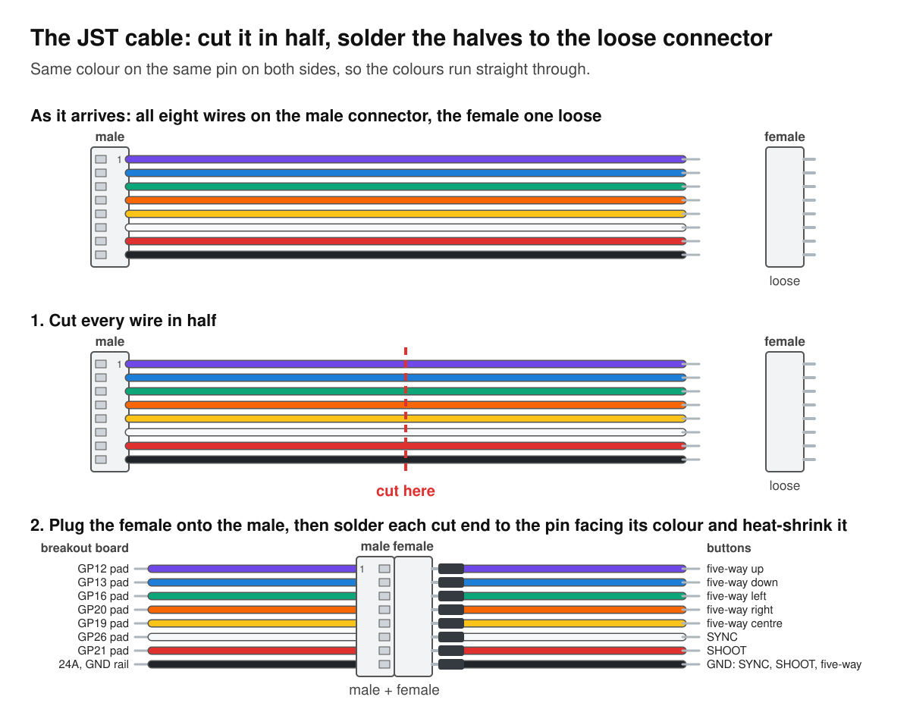

</details>

### 3.2 Breakout board
<details>
<summary>Show the breakout board steps</summary>

- Holes are column then row: `21C` is column 21, row C.
- Numbered circles are wires that leave the board.

The first drawing is a preview of the finished board. Build it in the six steps that follow.

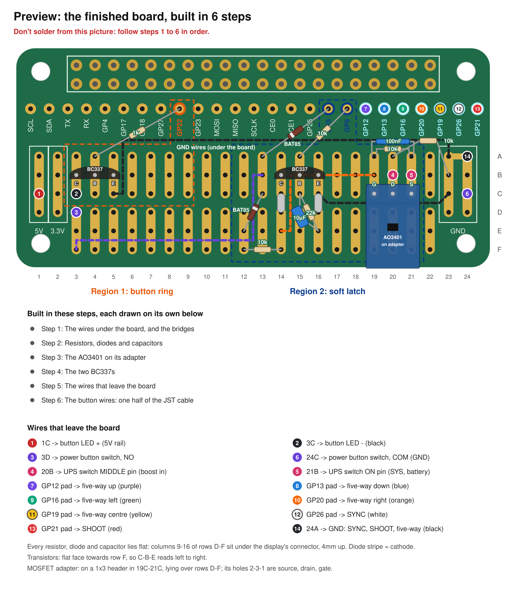

#### 3.2.1 Wires under the board

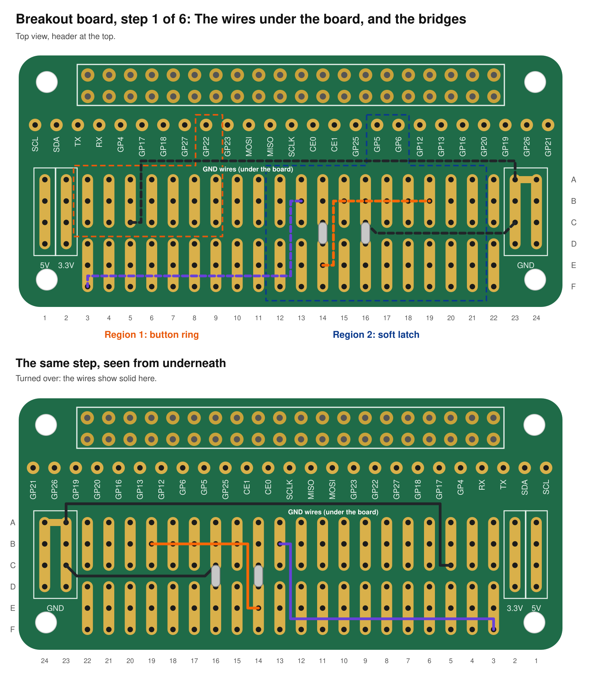

These wires go on first, use 20AWG solid-core wire. Bend the wires first and use a piece of solid core for the bridges. Do not solder them immediately on.

1. Strip the end of a wire, then bend it to shape with round nose pliers. Before you bend the last section, first strip the end and then bend it. Otherwise stripping it might be more difficult.
2. Bend the two bridges the same way, and fit all of them before soldering any. The second
   one, 16C to 16D, makes 16D-F GND too, for the 10µF and the 22k in step 2.
3. Solder the bridge and the orange wire's end at 14E together. 14D and 14E share a strip,
   so if solder fills the holes there, it does no harm: both are already in.
4. Solder the rest.

#### 3.2.2 Resistors, diodes and capacitors

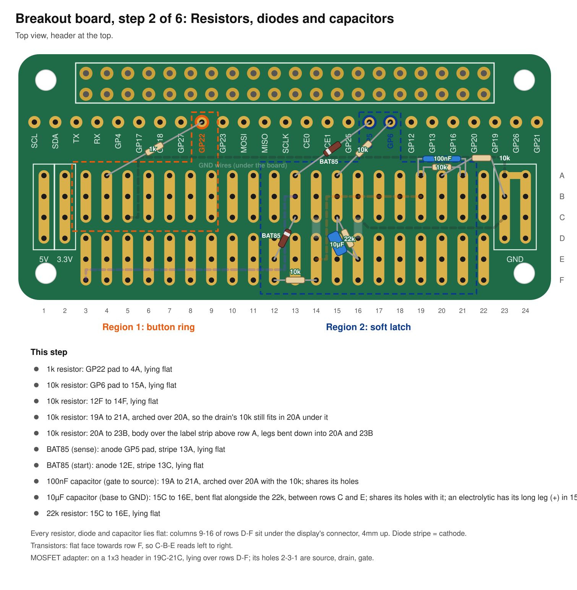

Use 1/8W resistors (about 3.5x1.8mm). Every part lies flat. The three that start at a
GPIO pad have to anyway, because their strips are too far away for a bent-over leg: the 1k from GP22
to 4A (about 13mm), the 10k from GP6 to 15A and the BAT85 from GP5 to 13A. Put heat-shrink
on the 1k's leg at the GP22 end, which passes close to the GP27 pad. The start diode lies
diagonally from 12E to 13C, with its legs bent right at the body. Both diode stripes go
in column 13: 13A and 13C.

The 10k from the gate to the source goes from 19A to 21A, arched a little over 20A: two
holes apart is just enough for its body, and the arch leaves 20A free. Another 10k goes from
that 20A to GND at 23B: its body lies over the label strip above row A, its legs bent down
into the two holes. Row A of columns 19-21 holds only these parts and the 100nF, so they
are easy to solder and to change; the gate wire and wires ④ and ⑤ go in row B, right
next to the MOSFET. The 10k from 12F to 14F lies flat the same way, over 13F. Nothing in columns
9-16 of rows D-F may stand up: the e-paper HAT's connector hangs over them and leaves 4mm,
and a 1/8W resistor stood up is about 5mm tall.

Two capacitors. The 100nF goes in the same holes as the gate's 10k, 19A and 21A, arched
over 20A with it: keep each pair of legs to one side of its hole. The 22k goes
from 15C to 16E, lying flat diagonally, and the 10µF goes in the same two holes, bent flat
alongside it. Both run from the BC337's base to GND: 16E is GND through the bridge at
16C-16D. A ceramic 10µF can go either way round; an electrolytic has its long leg (+) in
15C, but lying flat it is 4-5mm high, which is as much as the 4mm under the display's
connector or more, so use a ceramic one here. Why they are there is in
[docs/power-button.md](docs/power-button.md).

#### 3.2.3 MOSFET

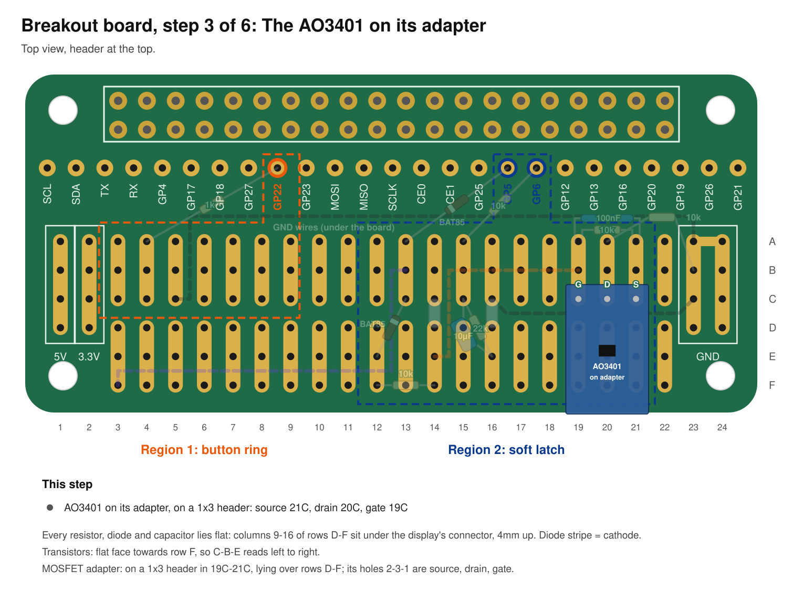

The AO3401 is too small to hold with your fingers. Pick it up with tweezers, place it on
the adapter with its pin 1 at the dot, and keep it pressed down with the tweezers while
you solder the first pin; that one joint then holds it for the other two. The adapter goes
onto the board on a straight 1x3 pin header: header into 19C-21C, adapter on top of it,
parallel to the board, reaching out over rows D-F of columns 19-21, which is why nothing
else goes there. Its holes read 2-3-1, which is source, drain, gate. The hole marked `1`
goes over 19C, so the drain lands in 20C and the source in 21C. On the header it sits
about 5mm high, clear of the display's connector, which ends at column 16.

Check: 19C, 20C and 21C don't beep to each other.

#### 3.2.4 Transistors

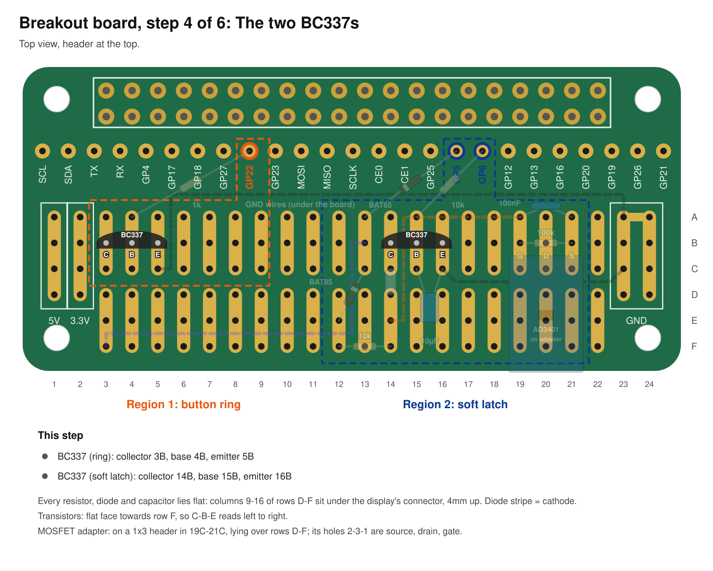

Measure each BC337's pinout first; makers differ. On the diode range the base reads about
0.7V to both other legs, and the emitter reads slightly higher than the collector.
Flat face towards row F, round side towards the header: collector left, emitter right.

Check: 3B, 4B, 5B and 14B, 15B, 16B don't beep to each other.

#### 3.2.5 Wires that leave the board

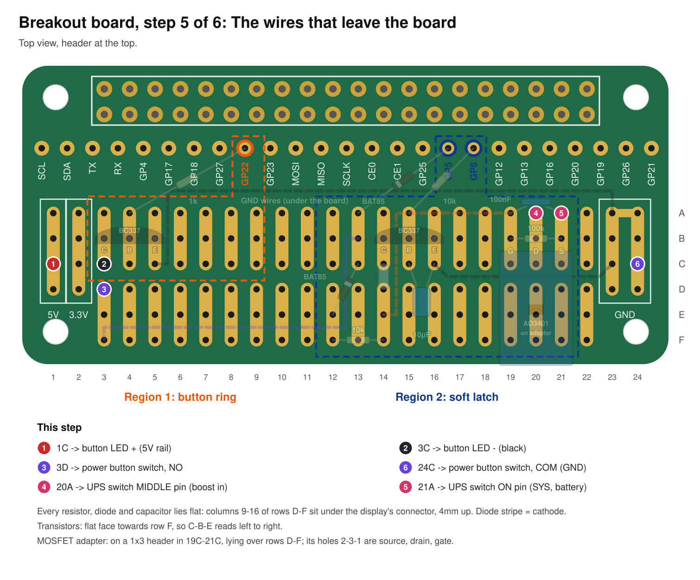

These go on last, so they don't hang in the way while you turn the board over. ①, ② and
③ sit side by side at the left edge, thanks to the purple wire from step 1, so the power
button's wires run straight off the board, clear of the parts, when you move it about
while fitting it. ④ and ⑤ go to the UPS HAT's old power switch pads and carry up to 1.5A,
which 20AWG handles easily over a few centimetres. With the switch off, the ON pad reads
battery voltage, the middle pad 0V. Heat-shrink every joint.

Check: ④ and ⑤ don't beep to each other.

#### 3.2.6 Button wires

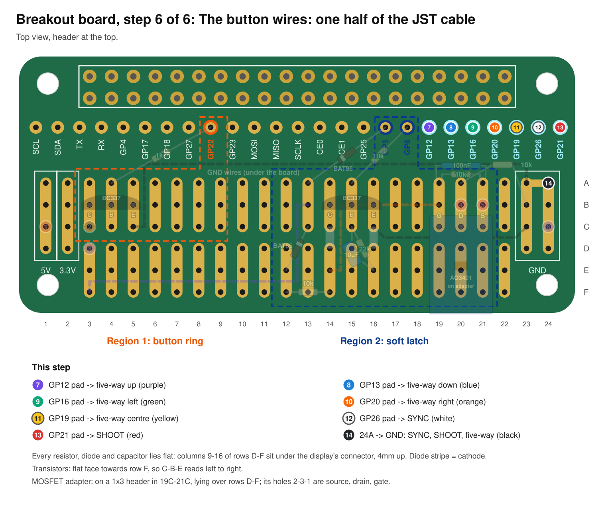

The male half of the JST cable (3.1): purple into the leftmost pad, through red into the
rightmost, and black into ⑭ for the buttons' ground.

Check: once the buttons are on (3.5), each pad beeps to GND only while its button is
pressed.

#### 3.2.7 Header

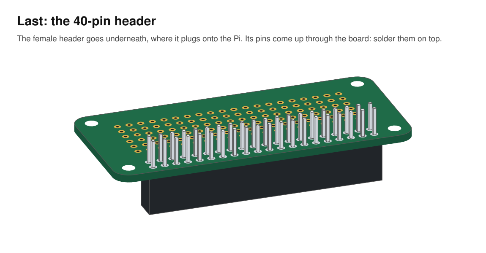

The 2x20 female header goes on last: it is the tallest part, and the board no longer lies
flat once it is on. It sits underneath the board, where it plugs onto the Pi, with its
pins coming up through the holes; solder them from the top. One pin at each end first,
check the header sits square, then the other 38.

Check: no solder bridges between pins - look closely along both rows.

How the circuits work, with schematics: [docs/power-button.md](docs/power-button.md).
The drawings are generated: edit `scripts/breakout_drawing/layout.py` and run
`./scripts/draw-breakout.py`.

</details>

### 3.3 Power cable
<details>
<summary>Show the power cable</summary>

The USB-C socket's red wire goes to pad 1 (VBUS) of the micro-USB plug and the black wire
to pad 5 (GND); the three pads between stay empty. The plug goes into the UPS HAT's
charging port.

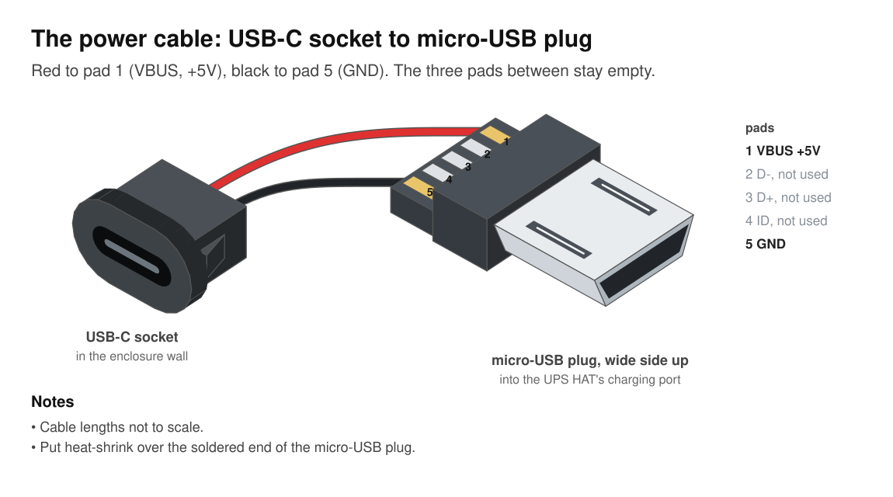

With the wide side up (the side with the two latch slots) and the tip pointing away from
you, pad 1 is on the left. Check it before soldering: push the bare plug into the UPS
HAT's charging port, and pad 5 should beep to the HAT's ground. If the other outer pad
does, trust the meter and swap red and black.

</details>

### 3.4 Data cable
<details>
<summary>Show the data cable</summary>

The USB-A socket's four wires go to the second micro-USB plug: red to pad 1 (VBUS), white to
2 (D-), blue to 3 (D+), black to 5 (GND); pad 4 stays empty. The plug goes into the Pi's
data port, the one marked `USB`, and the camera's cable plugs into the socket.

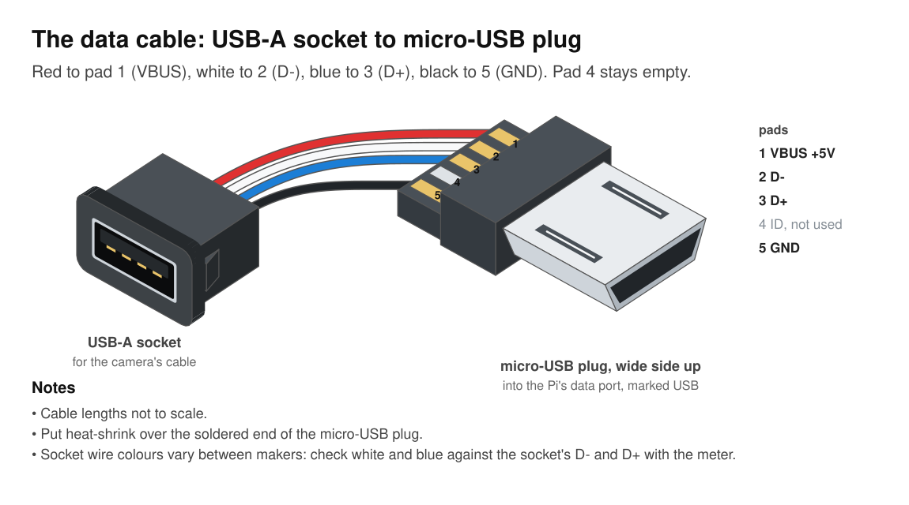

Wire colours on these sockets vary between makers, so check white and blue against the
socket's D- and D+ with the meter before soldering.

</details>

### 3.5 Buttons
<details>
<summary>Show the buttons</summary>

The female half of the JST cable goes to the buttons. Purple, blue, green, orange and
yellow go to the five-way's pins in its own order: up, down, left, right, centre. White
goes to SYNC and red to SHOOT. Black goes to the ground leg of SYNC and SHOOT, and a short
wire carries it on from there to the five-way's ground pin.

Find the power button's terminals with the multimeter first: `+`/`-` for the ring, and
the `COM`/`NO` pair that closes only while pressed. `NC` is not used.

</details>

</details>

## 4. Install

<details>
<summary>Show the install steps</summary>

On a Mac, with a blank SD card and an ssh key at `~/.ssh/pi_deploy_key`.

**Flash the card and boot it once.** Plug the Pi into the **middle** micro-USB port (`USB`),
not `PWR IN`: that one carries no data.

```bash
./scripts/flash-sd.sh --list                     # find the card, e.g. /dev/disk4
sudo ./scripts/flash-sd.sh --disk /dev/disk4     # asks for a password for `pi`
./scripts/enable-gadget-network.sh               # card still in the Mac
# put the card in the Pi, plug it in, and give it ~3 minutes: it reboots twice by itself
```

**Connect to it.** Try these in order, and stop at the first one that works.

<details>
<summary>Option 1: USB cable</summary>

```bash
ssh-copy-id -i ~/.ssh/pi_deploy_key.pub pi@10.55.0.1
sudo ./scripts/share-internet-macos.sh           # the Pi has no network of its own
```

Your computer or cable may not be suitable. A charge-only cable carries no data, and on
macOS 27.2 the Mac's USB network link has been seen to stop sending after 178 packets, so
the Pi never answers. If `ping 10.55.0.1` gets no reply, go to option 2.

The address for the next step is `10.55.0.1`.

</details>

<details>
<summary>Option 2: Wi-Fi</summary>

Unplug the Pi and put the card back in the Mac. `enable-wifi.sh` asks for the network's
name and password, and also authorizes your ssh key. The Zero 2 W only has 2.4 GHz.

```bash
./scripts/enable-wifi.sh                         # add --country XX outside the Netherlands
# put the card in the Pi and plug it in; it reboots once by itself
```

Settings on your router may prevent this. A router with mixed WPA2/WPA3 security has been
seen to time out before the password is even checked. If the Pi does not appear, go to
option 3.

Find the address in your router's list of connected devices. The Mac must be on the same
network.

</details>

<details>
<summary>Option 3: Mobile hotspot</summary>

Turn on a hotspot with WPA2 on 2.4 GHz. On an iPhone, turn on **Maximize Compatibility** and
stay on the Personal Hotspot screen. Connect the Mac to the hotspot too, then do the steps in
option 2 with the hotspot's name and password. The install then uses your mobile data.

Find the address in the hotspot's list of connected devices.

</details>

**Install the software.** Point an ssh name at the address from the step above, in `~/.ssh/config`:

```
Host nd-timer
    HostName 10.55.0.1
    User pi
    IdentityFile ~/.ssh/pi_deploy_key
```

```bash
./scripts/deploy-to-pi.sh --host nd-timer
ssh -t nd-timer 'cd ~/ND-Long-Exposure-Timer && sudo ./scripts/setup-pi.sh --status-led-pin 22 --shutdown-pin 5'
ssh nd-timer 'sudo systemctl reboot'
./scripts/deploy-to-pi.sh --host nd-timer
ssh -t nd-timer 'sudo systemctl enable --now nd-timer'
```

**Over Wi-Fi or a hotspot, add `--no-boot-speedup` to the `setup-pi.sh` line.** Its boot
speed-ups turn off `wpa_supplicant`, which would cut the Pi off from Wi-Fi after the reboot.

`setup-pi.sh` takes 15-30 minutes. After that, `deploy-to-pi.sh --host nd-timer` is the only
thing to rerun when the code changes.

What each step does, and what to do if the panel looks wrong: [docs/installing.md](docs/installing.md).

</details>

## 5. Test the power circuit

<details>
<summary>Show the meter checks</summary>

The last step, once the software is installed. Do the diodes first, because that check needs
the power off. The expected voltages are worked out from the circuit, so if one differs by a
tenth of a volt or two, that is fine.

**Check 1: the diodes.**

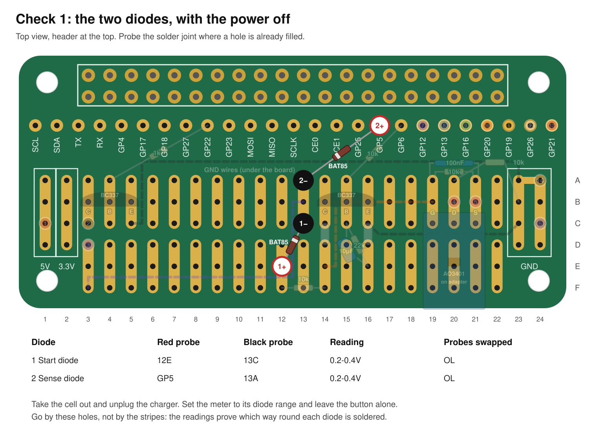

**Check 2: the voltages.** Put the cell back in and clip the black probe to GND, so you have
a hand free for the button. Take the display off the board to reach the points, and keep the
HAT's slide switch on OFF: on ON it bypasses the MOSFET and column 1 means nothing.

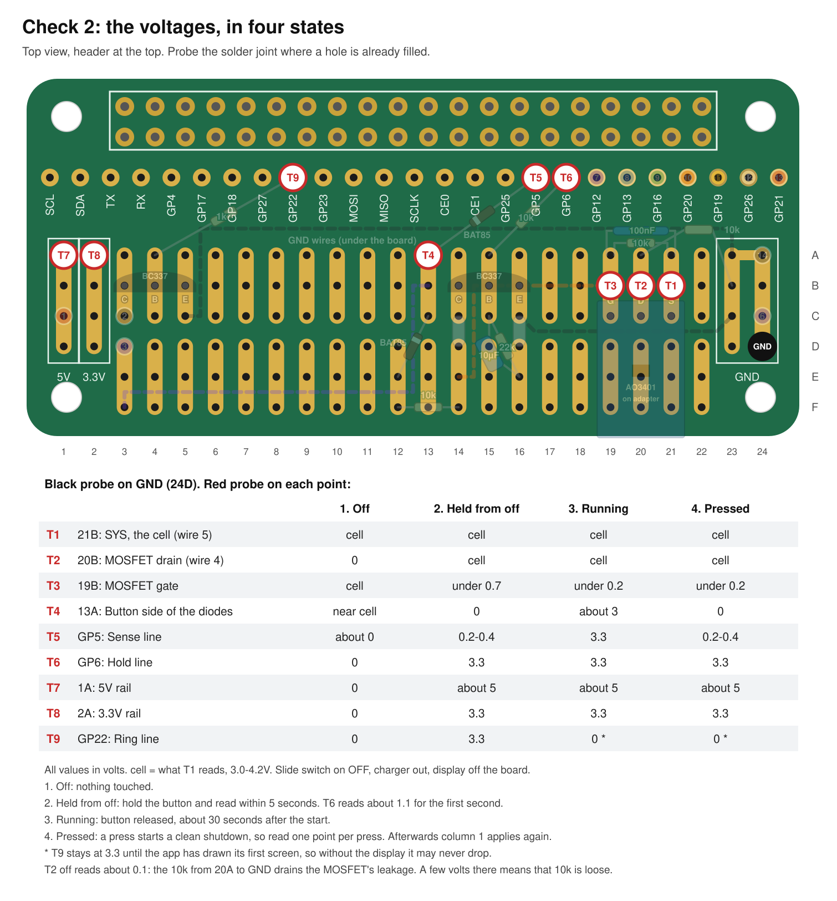

If a reading is off, this is where to look first:

| Reading | Look at |
|---------|---------|
| T2 reads the cell in column 1 | The slide switch is on ON, or the MOSFET is shorted |
| T2 reads a few volts in column 1, or it starts by itself after minutes | The 10k from 20A to 23B, loose or missing |
| T4 is not 0 while held | The button or its wires ③ and ⑥: `COM` and `NO` should beep only while pressed |
| T4 is 0 while held, T3 stays at the cell | The start diode or the 10k from 12F to 14F |
| T3 is low while held, T2 stays at 0 | The MOSFET, its adapter, or wires ④ and ⑤ |
| T2 reads the cell, T7 stays at 0 | Wires ④ and ⑤ on the wrong switch pads, or the HAT |
| T3 reads about 0.6 while held and the power drops when you let go | The hold transistor: T6, the 10k from GP6 to 15A, and the BC337's pinout |
| A short press shuts down, then the Pi starts again by itself | The 10µF and the 22k from 15C to 16E, and the bridge at 16C-16D |
| It switches on by itself when the cell goes in | The 100nF from 19A to 21A |
| T5 goes low without a press | The sense line is shorted, and the Pi will shut itself down |
| It switches on while charging, or starts again by itself about 2 minutes after a shutdown | The soft latch BC337: replace it (see below) |

**If it switches on by itself while charging, or keeps starting again after a shutdown,
replace the BC337s.** A BC337 that has been stressed - a short on the gate while it was
on, during testing for instance - can leak from collector to emitter with its base at
0V. It then keeps the MOSFET half on after a shutdown: the Pi halts but keeps its power,
and the watchdog starts it again about 2 minutes later. You can tell by T2: right after a
shutdown it should drop to about 0, and with a leaky BC337 it stays at about 2.6V while
15A (the base) reads about 0. A new BC337 costs a few cents and fixed exactly this on
2026-11-09. Replace both while you are at it: the ring's BC337 is the same part, and
the soldering is done anyway.

</details>

## Development

Run it on a laptop with `./scripts/simulator.py`, or use the browser link above. Tests,
lint and the rest: [docs/development.md](docs/development.md).
